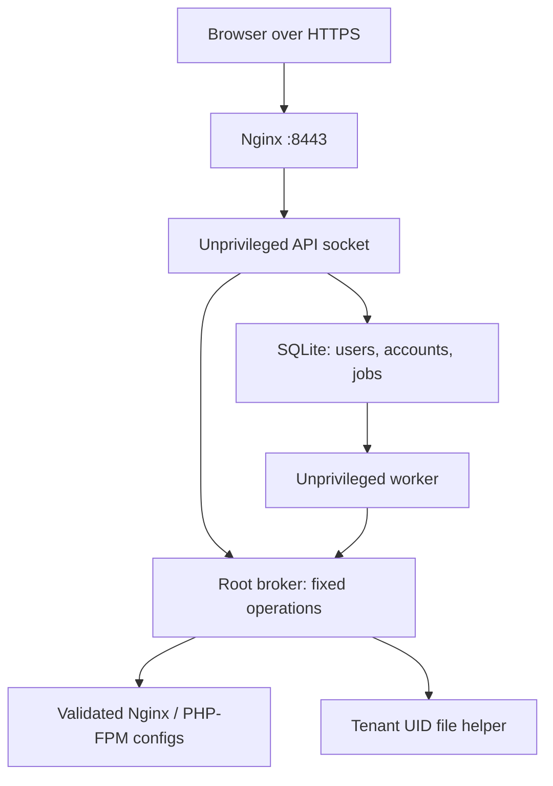

# Architecture
Copyright © 2026 Alma Tech Labs Inc. · LicenseRef-AlmaTech-Pending

## Scope and choices
The initial target is a small Ubuntu 24.04 VM. A single Python API process with two Waitress threads, one serial worker, one serial root broker and SQLite WAL avoid Redis/PostgreSQL overhead for panel state. Customer database services remain a separate future module. Vanilla JS avoids a build toolchain on the hosting server. This is a modular monolith with an explicit privilege boundary, not a root web application.

## Trust boundaries
- Nginx terminates TLS. Its HTTP upstream is a Unix socket at `/run/almapanel-api/http.sock`, mode 0660 with group www-data. It overwrites forwarded IP and scheme headers. The API trusts forwarded headers only because this socket is restricted to Nginx and the control-plane identity; it does not expose a trusted-proxy TCP port.
- API and worker run as `almapanel`, can write only panel state through systemd write-path exceptions, and cannot read tenant homes or agent state.
- Root agent accepts framed JSON on `/run/almapanel/agent.sock`. Both file permissions and Linux SO_PEERCRED restrict calls to the dedicated almapanel UID. No TCP root listener, generic command endpoint, shell string evaluation, arbitrary service name or customer-selected system path exists.
- Agent root registry is separate from the application database. An unprivileged database edit cannot redirect the helper to a different UID/home path. A compromised API is nevertheless a trusted-broker compromise and may abuse allowlisted operations; this architecture does not claim protection against full control-plane compromise.
- All Linux identities use the `ap_` prefix. Account home is root-owned with tenant group traversal; `public_html` and `runtime` are tenant-owned mode 0750. Nginx receives a narrow ACL. PHP executes under each tenant UID.
- The file helper is invoked using subprocess UID/GID and an empty supplementary-group list, no shell, fixed executable and clean environment. It opens components with `O_NOFOLLOW` directory descriptors and rejects hardlinks for read/write. Rename is Linux `renameat2(RENAME_NOREPLACE)`.

## Authorization and tenancy
`users.role` is admin/reseller/user. Admin can manage all accounts. A reseller can manage accounts where `owner_id` equals the reseller ID, within their account count. A user can operate only on their own `user_id`. Lookups return 404 across account boundaries. API endpoints check authorization before contacting the broker. Package domain counts and reseller account counts are checked under SQLite `BEGIN IMMEDIATE` to serialize reservations.

## State and jobs
Account creation inserts a disabled login and provisioning account plus a queued job in one transaction. The worker claims jobs under a write lock, calls the agent, then commits succeeded/failed state and an audit event. The worker handles SIGTERM by finishing the current RPC before stopping (bounded systemd timeout). On startup old running jobs become interrupted, never blindly replayed. Interrupted provisioning requires manual reconciliation.

The OS and SQLite cannot share an atomic transaction. Root registry records provisioning intent before creating resources. Failed user creation retains failed state and resources instead of deleting possibly valuable data. Nginx/PHP config changes are atomic file replacements with validation before reload; on validation/reload error originals are restored and revalidated. A crash between successful reload and registry save requires reconciliation. This is explicitly not a fully transactional hosting platform.

## Resource isolation limits
POSIX identities protect private files. PHP-FPM ondemand pools use two children and PHP memory_limit 96M, but these are not complete OS resource quotas. PHP open_basedir is defense in depth, not a sandbox. No cgroups, process containment, seccomp for customer scripts, disk/inode quotas, bandwidth quotas or tenant network isolation have been implemented. A tenant PHP application may spawn child processes or access network services under its own UID. No hostile shared hosting claim is made.

## Extending safely
Introduce database/DNS/mail/ACME/Git modules only with broker allowlist schemas, root-owned resource registries, explicit ownership checks, error semantics, service validation, integration tests and UI. Git build scripts must execute in constrained tenant services, never the agent's root process. Avoid passing secrets in process arguments or persisting plaintext credentials in jobs. Add migration versions before changing schema; currently only schema version 1 exists.
